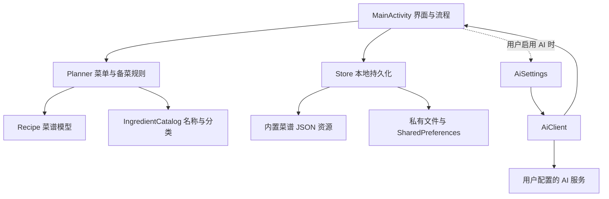

# 三餐有数 · 安卓家庭菜单

一个无需注册、离线可用的家庭菜谱与备菜 App。应用名称为「三餐有数」，包名 `cn.caidan.app`，当前版本 `0.1.3`，支持 Android 8.0 及以上。

## 数据来源与致谢

本项目内置的 **331 道基础菜谱整理自 [Anduin2017/HowToCook](https://github.com/Anduin2017/HowToCook)**。感谢原作者及项目贡献者提供菜谱、食材说明和烹饪步骤。

- **使用版本：** 固定到上游提交 [`308cc8b7dab1da84b20e7fafdf836a715437f582`](https://github.com/Anduin2017/HowToCook/tree/308cc8b7dab1da84b20e7fafdf836a715437f582)。
- **菜谱数据许可：** 上游该版本使用 [Unlicense](https://github.com/Anduin2017/HowToCook/blob/308cc8b7dab1da84b20e7fafdf836a715437f582/LICENSE)，本仓库及 APK 均保留[许可证原文](android/app/src/main/assets/HOWTOCOOK-LICENSE.txt)。
- **来源记录：** [recipe-source.json](android/app/src/main/assets/recipe-source.json) 记录数据版本和导入范围；每道菜谱保留上游原文、文件路径及对应版本的来源链接。
- **导入处理：** 本应用对菜谱进行结构化导入、份量换算与菜单搭配，解析及估算规则见[菜谱数据说明](docs/recipe-data.md)。

## 安装

下载并安装 [CaiDan-0.1.3-debug.apk](https://github.com/wang-ironman/SanCanYouShu/raw/refs/heads/main/artifacts/CaiDan-0.1.3-debug.apk)（仓库文件：[artifacts/CaiDan-0.1.3-debug.apk](artifacts/CaiDan-0.1.3-debug.apk)，校验值：[SHA-256](artifacts/CaiDan-0.1.3-debug.apk.sha256)）。使用与首版相同的本地测试签名，可以覆盖安装并保留数据，尚未上架应用商店。

## 使用

1. 首页点击「构建菜单」，选择开始日期、1–14 天、1–12 人以及早餐／午餐／晚餐。
2. 午晚餐可选 1–3 道菜，早餐每餐安排一道早餐或主食。可以填写不吃的食材关键词。
3. 点击「生成菜单」，默认规则会尽量避免跨餐重复，并优先搭配荤菜、素菜和汤。午晚餐的米饭不自动添加，需要时可换入主食或自行准备。
4. 在每天的菜单中点菜名查看做法，点「换菜」替换其中一道。备菜清单随菜单重新计算，已备状态会清空供重新核对。
5. 「备菜」可查看整个周期或单日清单。同种食材只显示一行，用量按人数缩放、可换算单位相加；克、个等不能换算的数量保留在同一行。选好项目后点击「完成备货」移出清单，也可以先「全选」。可通过安卓分享发送剩余清单。
6. 「菜谱」支持菜名／食材搜索、分类、收藏与自建。自建菜谱每行填写 `名称 | 数量 | 单位 | 备注`，数量未知可留空；保存后参与规则搭配，也可编辑或删除。当前菜单正在使用的自建菜谱须先换菜再删除。

菜单按手机本地日期自动更新：今天之前的菜单记录会清理，只展示今天及以后。例如周三打开应用，周一、周二的菜单和对应过期备菜需求已移除。打开应用、回到前台和应用前台跨日时都会检查；今天和未来已完成的备菜状态继续保留。整份菜单全部过期后，首页会回到可构建新菜单的状态。构建菜单的开始日期从今天起选择。

## 家里已有食材

首页点击「管理食材」，添加番茄、鸡蛋、土豆等食材名称，多种食材可用逗号、顿号或换行分隔。可以逐项移除或清空，点击「保存食材」后生效，关闭应用后仍保留。构建菜单时也可以进入管理。

自动搭配在满足忌口、餐次、荤素类别和尽量不重复的前提下，优先选择用到已有食材的菜谱；匹配种类越多，优先级越高。菜谱库和换菜列表也按匹配种数优先排序，并标出“用到已有”的食材。支持番茄／西红柿、土豆／马铃薯等常见别名，其余按食材名称匹配。

AI 选菜时会收到已有食材与候选菜谱的匹配信息，要求优先使用；具体结果由所配置的模型生成。本功能仅记录名称，不记录剩余数量，不会自动扣减备菜用量或标记已备，食材用完后请自行移除。已有菜单不会因修改食材列表自动改动，可重新生成或手动换菜。

## 备菜整理与清空

同种食材按常见别名和切法统一，比如番茄／西红柿、生姜／姜片、蒜／蒜末。用量不同单位分别保留在一行，例如 `300克 + 2个 + 待确认1处`，不会猜测“一个有多少克”。鱼虾归肉蛋水产，鱼露、蚝油等按调味品识别；未知名称归其他。

「全选／取消全选」作用于当前日期筛选。勾选后点击「完成备货」，已选项目会从清单移除，未选项目继续保留；切换日期和重启后也不会重新出现。菜单和菜谱保留，换菜带来的新食材需求会列入清单。需要恢复时点击「重新生成整份备菜清单」。新建菜单也会生成新清单。

点击一项食材可手动调整采购名称与分类。配置 AI 后可点击「AI 整理」，将食材名称发往自己的模型服务，查看建议并确认应用；未确认或请求失败不会改动数据。AI 只辅助名称与分类，不修改食材数量。确认的整理规则保存在本机，后续清单继续使用。

## 菜谱数据

基础数据随安装包下载到手机，无需首次联网。来源为 [Anduin2017/HowToCook](https://github.com/Anduin2017/HowToCook)，保留原文、对应版本的来源链接及许可证。数量和解析策略见 [数据说明](docs/recipe-data.md)。

“常见家常菜”没有统一的完整清单。本版以该来源的可烹饪菜谱作为第一批基础数据，不能据此保证覆盖所有地区的大多数家常菜。

原方没有注明份数时默认以 2 人估算。原方为“适量”、区间、公式或数量不清楚时，清单列为“待确认”，保留说明，不推算成确定数量。备菜前应核对原方，尤其是食量、调料和可选配料。忌口按关键词筛选，不能代替逐项核对过敏原。

## 可选 AI

在「设置」中填写兼容的服务地址、API Key 和模型 ID。可获取 `/models` 模型列表，也可直接输入 ID。服务地址可以是 `https://服务域名/v1`，也支持供应商已有的兼容路径。

- **文字选菜：** 构建菜单时启用 AI 并描述要求。模型只能从现有且符合忌口关键词的菜谱中选择；返回的日期、餐次、菜数和菜谱编号会在本机校验。请求失败或结果无效时保留原菜单，可以重试或改用规则生成。
- **截图导入：** 在菜谱库选择图片，确认预览后发送给配置的服务。须使用支持图片输入的模型。识别结果进入可编辑草稿，核对食材和步骤后才保存。
- API Key 使用 Android Keystore 加密保存在本机。普通菜谱、菜单和勾选状态在应用私有目录保存；卸载或清除应用数据会删除这些记录。没有云同步。
- 使用 AI 时会向用户配置的服务发送请求内容；识别截图需要上传所选图片。对应服务可能收取费用。本 App 不附送模型密钥。

## 技术栈与架构

| 层次 | 实现 |
| --- | --- |
| 应用 | 原生 Android，Java 17 语法，Android Views 与系统组件；包名 `cn.caidan.app` |
| 构建 | Android Gradle Plugin 8.13.2、Gradle 8.13、JDK 17+、compile/target SDK 36、min SDK 26 |
| 运行时依赖 | 界面与业务逻辑无第三方运行时依赖；使用 Android 平台 API 和 `org.json` |
| 菜谱数据 | 随 APK 打包的 JSON 资源；导入脚本使用 Python 3 标准库及 Git，不依赖 Python 第三方包 |
| 测试 | 原生 Android Instrumentation (`AcceptanceRunner`)，没有单独的普通单元测试命令 |

主要模块职责：

- `MainActivity`：原生界面、用户交互及页面流程编排，调用规则、存储和可选 AI 模块。
- `Planner`：独立 Java 菜单规则、忌口与餐次筛选、已有食材匹配优先、AI 结果校验，以及按人数缩放、食材合并和单位换算。
- `Recipe`：菜谱与食材的数据模型和 JSON 映射。
- `IngredientCatalog`：食材名称规范化、别名归一和采购分类规则。
- `Store`：加载内置菜谱，保存用户菜单、自建菜谱和整理规则，并管理收藏、勾选及家中食材。
- `AiSettings` / `AiClient`：保存 AI 服务配置与加密密钥；通过兼容 OpenAI 格式的 HTTPS API 获取模型、生成菜单、整理食材或识别图片。



### 菜单和备菜数据流

规则生成先按日期、餐次、忌口与菜谱适配条件筛选候选菜，再在尽量避免重复的同时提高已有食材匹配更多菜谱的优先级。菜单保存食谱编号及输入快照。备菜清单根据菜单中的菜谱、人数与食材用量重新汇总：常见别名和切法归并，同名食材合并，可换算单位先统一后相加，不能换算的单位并列保留，未知数量保留为待确认。完成备货记录与当前需求关联；换菜会据新菜单重新计算。应用启动、回到前台和日期变化时会移除今天之前的餐次及过期需求，保留今天和未来餐次。

### 本地数据、网络与隐私

- `Store` 使用应用私有目录中的 `AtomicFile` 保存 `plan.json`（包括菜单与备货完成记录）、`custom.json`、`ingredient-rules.json`；收藏、备菜勾选和已有食材名称使用私有 `SharedPreferences`。内置菜谱随安装包提供。没有云同步；卸载或清除应用数据会删除本地记录。
- AI 为可选功能。菜单生成、备菜、菜谱浏览与基础规则无需联网。用户主动调用 AI 时，相关文字或所选截图会发送到其设置的服务；截图识别结果先成为可编辑草稿，用户确认保存前不会写入菜谱。
- 清单 AI 整理只把名称发往配置的模型，先展示建议，确认后才保存名称／分类规则；不改变数量。
- 应用声明 `INTERNET` 权限。AI 服务地址默认要求 HTTPS，客户端拒绝重定向；仅 `localhost`、`127.0.0.1` 和模拟器 `10.0.2.2` 可用 HTTP，Android 网络安全配置也只为这些本机地址开放明文流量。AI Key 由 Android Keystore 中的 AES-GCM 密钥加密后保存在私有设置中。Manifest 禁止 Android 自动备份。

### 菜谱来源与导入

内置菜谱从 [Anduin2017/HowToCook](https://github.com/Anduin2017/HowToCook) 的菜谱 Markdown 导入。来源项目使用 Unlicense；许可证文本随资源保留。每道导入菜谱记录原文、来源路径和固定版本的提交链接。脚本只从原料与计算章节解析食材及数量，不确定数量保留原文并标为待确认；人数未注明时按两人估算并注明。具体规则见[数据说明](docs/recipe-data.md)。

## 开发与验证

构建需要 JDK 17+、Gradle 8.13 和 Android SDK 36。仓库脚本 `scripts/build-android.ps1` 默认假定已有 Gradle、SDK 和 JDK 工具目录；在其他开发机可通过 `-ToolRoot` 指定含 `gradle-8.13` 与 `android-sdk` 的工具根目录，并设置 `JAVA_HOME`、`ANDROID_HOME` 覆盖 JDK 与 SDK 路径：

```powershell
./scripts/build-android.ps1 -ToolRoot <工具根目录> -TestApk
```

也可在 Android Studio 打开 `android` 并配置本机 SDK，或在 `android` 目录使用 Gradle 构建：

```powershell
gradle assembleDebug
gradle assembleDebugAndroidTest
```

需要在已连接的 Android 设备或模拟器运行 Instrumentation 时，先构建并安装 APK 和测试 APK，再执行：

```powershell
adb install -r artifacts/CaiDan-0.1.3-debug.apk
adb install -r android/app/build/outputs/apk/androidTest/debug/app-debug-androidTest.apk
adb shell am instrument -w cn.caidan.app.test/cn.caidan.app.AcceptanceRunner
```

历史验收记录及适用边界见[验证记录](docs/verification.md)。该文档记录的模拟器断言与操作属于对应历史版本的验证，不代表每次构建或本次上传都重新运行了这些测试。
